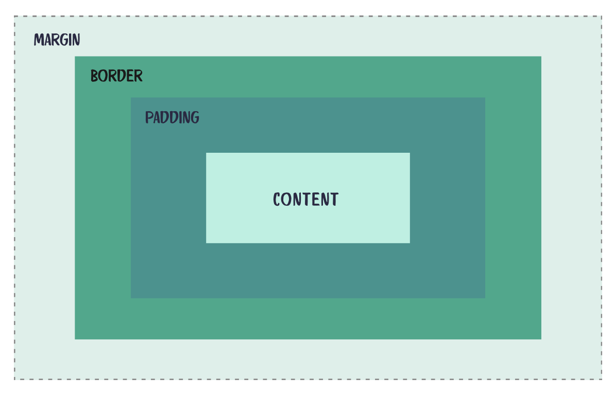

# WebDevWorkSSSShop
## welcome to the world of web dev 😍

Websites are often built using 3 languages:
- **HTML** (the structure of the website)
- **CSS** (the design and layout of the website)
- **JavaScript** (the "brains" of the website)
    

For example, on YouTube:
- HTML would be used to add content like links, videos, images, and text.
- CSS would be used to arrange everything on the page and style it with colors, fonts, and spacing.
- JavaScript would be used to make things interactive, like when the user presses play, pause, or next.
    
In this workshop, we'll be going through the basics of HTML and CSS!

### How to use this template!
1. Download the files as a ZIP file or clone the repository to your computer.
2. Edit the HTML and CSS files to personalize your website with your own content, colors, fonts, and layout.
   - Update all the relevant links and images in the HTML to point to your own websites, social media profiles, and image files.
   - Replace the placeholder text and images with your own content.
3. Open *index.html* in your browser to preview your changes as you work!
   - use the `Live Preview` or `Live Server` extensions on VSCode to help you view your website while you work

### HTML (HyperText Markup Language)

**Anatomy of a Tag**

```
<h1 class="title">Hello World!</h1>
```

- opening tag → `<h1>`
- attribute → `class="title"` (gives the element a class name that we can use to style it with CSS)
- content → `Hello World!` (the text that appears on the page)
- closing tag → `</h1>` (marks the end of the heading element)
    

**Page Skeleton**

```html
<!DOCTYPE html>
<html lang="en">
<head>
    ...
    <title>My Page</title>
    ...
</head>

<body>
    <h1>Hello, world!</h1>
</body>

</html>
```

- `<!DOCTYPE html>` → tells the browser that we're using HTML5.
- `<html lang="en"></html>` → wraps all the HTML on the page and tells the browser that the page is written in English.
- `<head></head>` → contains information about the webpage, like its title, fonts, and links to CSS files.
- `<body></body>` → contains the content that appears on the webpage, like headings, paragraphs, images, and links.
- `<title></title>` → sets the title shown in the browser tab.
- The browser reads the HTML to figure out what content to display and how the elements are organized.
    

### CSS (Cascading Style Sheets)

CSS is used to style HTML elements by changing things like their colors, fonts, sizes, and spacing.

```css
h1 {
    color: #24a98b;
}
```

- selector → `h1` (selects all `<h1>` elements on the page)
- property → `color` (specifies what we want to change)
- value → `#24a98b` (sets the text color to a shade of green)

	
**The Box Model**

Every HTML element can be thought of as a box. The CSS box model describes the different layers that make up that box:

- Content → the actual text or image inside the element.   
- Padding → the space between the content and the border.
- Border → the outline around the element.
- Margin → the space outside the border, separating the element from other elements.
    



*Changing Fonts*

1. Choose a font from [Google Fonts](https://fonts.google.com/?utm_source=chatgpt.com).
2. Select the font style you want to use and copy the HTML `<link>` code from the font's page.
3. Add the `<link>` code inside the `<head>` section of your HTML file.
4. Use the font's name in your CSS with the `font-family` property.
    


Example:

Add this inside your HTML `<head>`:

```html
<link rel="preconnect" href="https://fonts.googleapis.com">
<link rel="preconnect" href="https://fonts.gstatic.com"crossorigin>
<link href="https://fonts.googleapis.com/css2family=Robotodisplay=swap" rel="stylesheet">
```

Then use the font in your CSS:

```css
body {
    font-family: 'Roboto', sans-serif;
}
```

**Color Palettes**

- Use [Coolors](https://coolors.co/?utm_source=chatgpt.com) to find color palettes that work well together.
- Copy the hex codes for the colors you want to use (for example, `#24a98b`).
- To make it easier to change colors across your website, you can store them in CSS variables and reuse them throughout your styles.
    

Example:

```css
:root {
    --primary-color: #24a98b;
    --background-color: #f5f5f5;
    --text-color: #333333;
}

h1 {
    color: var(--primary-color);
}

body {
    background-color: var(--background-color);
    color: var(--text-color);
}
```

- `:root` → defines variables that can be used throughout the stylesheet.
- `--primary-color` → the name of a variable that stores a color.
- `var(--primary-color)` → uses the color stored in that variable.

If you want to try a different color palette later, you can simply change the values in `:root` instead of updating every CSS rule individually.


## Things to look into after the workshop!!
- **Favicons** → add a small icon that appears in the browser tab next to your website's title.
- **Changing up the style of your website!** → experiment with different fonts, colors, layouts, animations, and hover effects to add your own style to the website!
- **Adding more pages**→ create additional *separate* pages for things like an About Me section, projects, hobbies, or a contact page, and link them together using navigation links.
- **Adding a light or dark mode** → let users switch between light and dark themes.
- **Deploying your website** → publish your website online so other people can visit it using a link!
